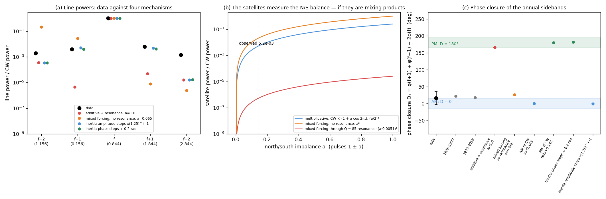

# The Chandler wobble as a magnetized spheroid: a supplementary view

This directory is a **supplementary view of the Chandler wobble (CW) model** in this repository. The core model
(`../cw_physics.py`, `../cw.py`) is a damped 432.3-day oscillator kicked twice a year by impulses whose size is the
squared draconic (27.2122-day) lunar cycle. The documents here ask what that model looks like when read as a
laboratory device, as the QBO and ENSO were read as toroidal plasma devices in `gem-lte-core/docs`:
- Euler's equations for a spinning body are the Landau–Lifshitz equations for a uniformly magnetized ellipsoid,
  with the shape (demagnetizing) tensor in place of the inverse inertia tensor;
- so the free Chandler wobble is the uniform precession (Kittel) mode of a polar-magnetized spheroid;
- the lunar tide plays a coaxial (wavenumber 0) electromagnet whose torque is quadratic, B², blind to the field's sign.

Three ingredients organize the picture: the **electromagnet** (the draconic B² drive), the **carrier** (impulsive
changes in the moment of inertia twice a year, the only way the drive reaches the mode) and the **pear shape**
(unequal north and south pulses, which modulate the wobble's amplitude through the year).

*The essential fit (`cw_flagship.py`): the device against `../cw.dat`.*
- *The CW line at 0.844 cycles/yr (432.8 d) is a prediction, |2f_D − 26| for the draconic frequency f_D and a
  semiannual comb, not a fitted period.*
- *One timing parameter is fitted on 1935–1990: the day of the enlarging pulse (day 251; the other pulse falls on day
  68). 1990–2018 is held out: r = 0.84 in training, 0.85 held out.*
- *The satellites at 1 ∓ CW (0.156 and 1.844 cycles/yr) are amplitude-modulation products of the carrier. The
  device reproduces their level, their phase relation and the season of largest amplitude (day 337). The step size
  (×1.25) and the search window for the pulse day (days 230–262) were both taken from the sidebands, so these three
  matches check consistency; they are not independent predictions.*

*In the time domain the device is no better than a plain sinusoid at the predicted frequency (0.84 / 0.88). Its
distinguishing evidence is spectral: the line positions, the sideband phases, and the failure of every other lunar
month or folding rule.*

## Documents

| Document | What it covers |
|---|---|
| [cw_magnetized_spheroid.md](cw_magnetized_spheroid.md) | The full treatment. §1 the exact Euler ↔ Landau–Lifshitz equivalence (Kittel mode = Chandler wobble). §2 the device: B² electromagnet, inertia comb, pear shape. §3 one alias rule for the QBO (B, alternating comb → 2.370 yr) and the CW (B², same-polarity comb → 432.8 d), and why only the draconic month works. §4 device variants against `cw.dat`. §5 the sidebands are mixing products, not resonance-filtered lines, and measure the north/south balance. §6 a nanomagnet version as a laboratory test. |
| [../README.md](../README.md) | The core impulse model and its spectral estimators (FFT, MEM, AR-z). |
| [../ChandlerWobbleForcing.pdf](../ChandlerWobbleForcing.pdf) | The 2021 blog post: asymmetric north/south impulses produce the satellite peaks at 0.157 and 1.843 /yr. |
| [../dialog.pdf](../dialog.pdf) | The aliasing derivation of the 432.8-day period, and the earlier view that no laboratory test is possible. |
| `~/eval/gem-lte-core/docs/qbo_tokamak.md` | The companion QBO device (reversing poloidal drive, the same comb and draconic alias, here with the sign kept). |

## Selected figures

*The device and the exact equivalence (`cw_magnetized_spheroid.py`).*
- *Left: the pear-shaped, polar-magnetized spheroid beside a coaxial electromagnet driven by the Moon's ecliptic
  latitude, with the inertia comb as the carrier.*
- *Right: a triaxial Euler top and its mapped macrospin agree to 10⁻¹⁰; the frequency matches both Euler's and
  Kittel's formula.*

*Which drive (`cw_magnetized_spheroid.py`).*
- *Top: without the comb the B² torque leaves no CW line; with it the line sits at 0.844 cycles/yr; the pear shape adds
  the 1 ∓ CW satellites.*
- *Middle: the wrong drives (declination/tropical month, sign-sensitive B, the QBO's alternating comb) put their
  lines at 0.42–0.74 cycles/yr and fit the data far worse (r = 0.40–0.55 against 0.84).*

*The sideband test (`cw_sidebands.py`).*
- *The phase closure D₁ = φ(f+1) + φ(f−1) − 2φ(f) of the data is 16° ± 19°: amplitude modulation (0°), not phase
  modulation or resonance-filtered forcing lines (both near 180°).*
- *Read as mixing products, the sideband level gives the north/south balance: a ±14% annual swing in wobble amplitude,
  largest in early December. Through the resonance even a fully one-sided comb would fall about 200× short.*

## Code and data

- Every figure has a script: `cw_flagship.py`, `cw_magnetized_spheroid.py` (the device, equivalence and variants)
  and `cw_sidebands.py` (sideband amplitudes, phase closure, N/S balance). Run them from this directory; the last two
  write `cw_magnetized_spheroid.json` and `cw_sidebands.json`.
- They read `../cw.dat` (the Chandler band of polar motion, 1935–2018.6 at 0.05 yr) and need only numpy, scipy and
  matplotlib. The lunar ecliptic latitude and declination are computed from Meeus' mean elements, as in the QBO
  scripts, so the lunar phase is astronomical rather than fitted.

These documents are exploratory. Where a result is negative or not yet decisive, the documents say so: the device
does not beat a sinusoid in the time domain, it does not follow the CW's multi-decadal amplitude changes, the
semiannual sidebands are too noisy to classify, and the annual amplitude modulation still needs checking against the
raw IERS polar-motion series to exclude a processing artifact.
