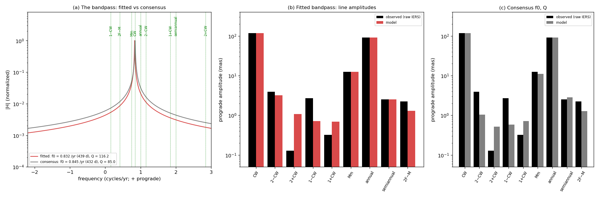
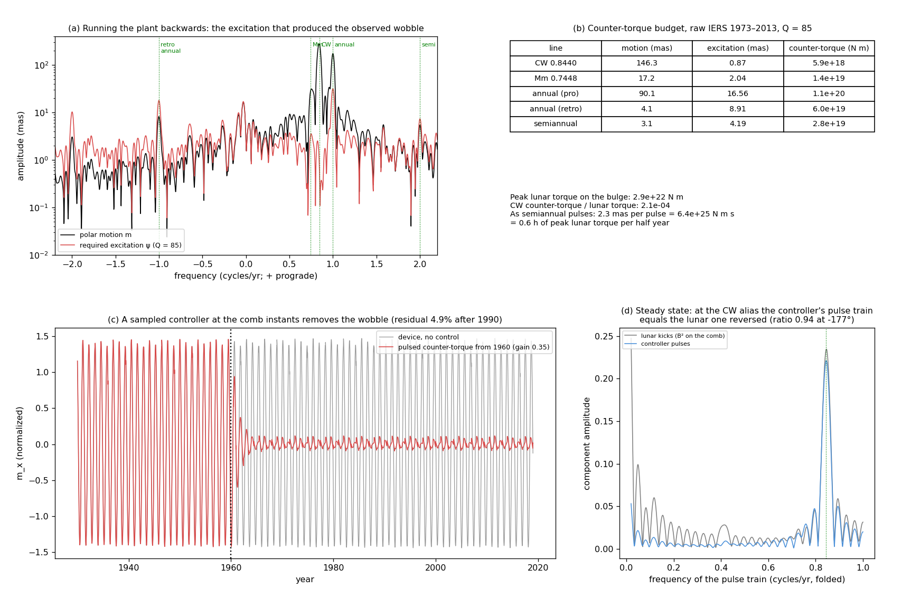
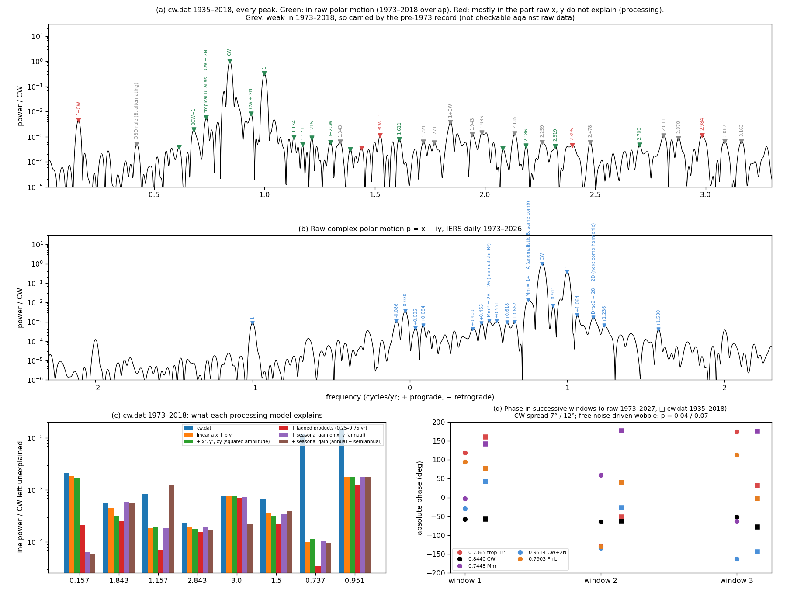
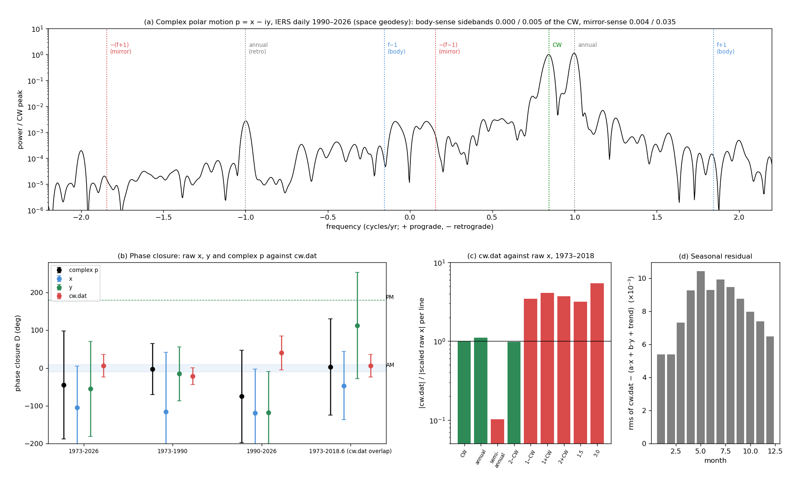

# The Chandler wobble as a synchronized rotational mode: a supplementary view

This directory is a supplementary view of the Chandler wobble (CW) model in this repository. It reads the model
(`../cw_physics.py`, `../cw.py`) the way the QBO and ENSO were read as toroidal plasma devices in
`gem-lte-core/docs`. This time the reference is rotating electromagnetic machinery and control theory:
- **Synchronization is ordinary.** A rotational mode whose phase is set by an external cyclic torque is routine in
  rotating machines.
- **The Earth's idiosyncrasy.** The lunar torque reaches the wobble only during impulsive, twice-yearly changes in
  the moment of inertia. That pulse comb samples the fortnightly torque, and the CW sits at the alias
  |2 × draconic − 26| = 0.8440 /yr. The Moon's distance cycle gives a second line, Mm, at 14 − anomalistic =
  0.7448 /yr.
- **Evidence from raw IERS polar motion (1973–2026).** Both lines are phase-locked: the joint chance under a
  noise-driven free wobble is 0.1–0.5%. Every comb line emerges at about its observed strength through a modest-Q
  bandpass (Q ≳ 30). The consensus Q ≈ 85+ was needed only to keep a free wobble ringing.
- **The control-theory check.** The counter-torque that would remove the wobble is 10⁻⁴–10⁻³ of the lunar torque on
  the bulge. A pulsed controller that removes it ends up firing the aliased lunar pulse train, reversed.

*The essential fit (`cw_flagship.py`), on raw IERS polar motion.*
- *The device: the astronomical lunar torque (ecliptic latitude squared × (a/r)³), gated by push-pull seasonal inertia
  pulses about 5.5 days wide, through one prograde mode with f₀ = 0.843 /yr and Q = 32.*
- *One timing parameter is fitted on 1973–2000. Held out to 2026, the Chandler band correlates at r = 0.75, the same
  as a fixed sinusoid: the time domain does not discriminate.*
- *The evidence is the line set (panel b: CW, Mm, annual, semiannual and 2 − CW at about their observed strengths)
  and the phase locks.*

## Documents

| document | what it covers |
|---|---|
| [cw_synchronized_wobble.md](cw_synchronized_wobble.md) | **The lead.** Synchronization in rotating machinery; the pulsed inertia comb and aliasing; the bandpass fitted without consensus constraints; the phase-lock evidence; the counter-torque and a pulsed controller; what would strengthen or break the case. |
| [cw_data_tests.md](cw_data_tests.md) | **The data.** Raw IERS against `cw.dat`. The `cw.dat` 1 ∓ CW side peaks are cross-terms of a seasonal gain in its processing. Every peak catalogued; phase stability of each candidate line (CW, Mm, the 0.817 feature, the other labelled lines); the joint chance; and a log of the claims these tests withdrew. |
| [cw_magnetized_spheroid.md](cw_magnetized_spheroid.md) | **The device appendix.** The Euler ↔ Landau–Lifshitz identity for the free mode; the first device (sharp kicks, 432 d, Q = 85); the alias table shared with the QBO; first fits against `cw.dat`; laboratory analogs. |
| [../README.md](../README.md) | The core impulse model and its spectral estimators. |
| [../ChandlerWobbleForcing.pdf](../ChandlerWobbleForcing.pdf), [../dialog.pdf](../dialog.pdf) | The 2021 satellite-peak post (based on a processed series; see data tests §2) and the alias derivation. |
| `~/eval/gem-lte-core/docs/qbo_tokamak.md` | The companion QBO device: the same comb and draconic alias, with the sign kept. |

## Selected figures

*The bandpass without consensus constraints (`cw_bandpass.py`). f₀, Q, pulse shape and asymmetry are free; the annual
has its own excitation. The 2 − CW line sets Q ≳ 30, and f₀ lands at 425–440 d.*

*Control theory (`cw_counter_torque.py`). Running the plant backwards gives the counter-torque that would remove the
wobble. A sampled controller at the comb instants removes the device's wobble, and its steady pulse train at the CW
alias is the lunar one reversed (0.94 at −177°).*

*Every peak (`cw_peaks.py`). Each `cw.dat` peak is classed as Earth, processing or pre-1973 only. The processing
models are compared, and the absolute phase of the candidate lines is tracked window by window.*

*Raw polar motion against `cw.dat` (`cw_eop_closure.py`). The upper side peak at 1.843 /yr is absent from raw data;
`cw.dat` carries 3–5× too much at 1 ∓ CW and has a seasonally varying residual.*

*The free-mode identity (`cw_magnetized_spheroid.py`), kept as mathematics, not as the working analog.*

## Code and data

- **Scripts:** each figure and JSON file has a script of the same name, run from this directory. The order:
  1. `fetch_eop.py`, to download the raw data;
  2. `cw_magnetized_spheroid.py`, `cw_sidebands.py`, `cw_eop_closure.py`, `cw_peaks.py`;
  3. `cw_bandpass.py`, then `cw_flagship.py` and `cw_counter_torque.py` (they read `cw_bandpass.json`);
  4. `cw_joint_lock.py`.
- **Data:**
  - `../cw.dat`: a processed x-pole series, 1935–2018.6, of unknown provenance.
  - `data/finals2000A.all`: IERS Rapid Service daily polar motion, 1973–now, downloaded by `fetch_eop.py`; not in the
    repository.
- **Lunar elements:** computed from Meeus' mean elements, so lunar phases are astronomical, not fitted. Only numpy,
  scipy and matplotlib are needed.

These documents are exploratory. Where a result is negative or not yet decisive they say so; the claims withdrawn
along the way are listed in [cw_data_tests.md §8](cw_data_tests.md).
