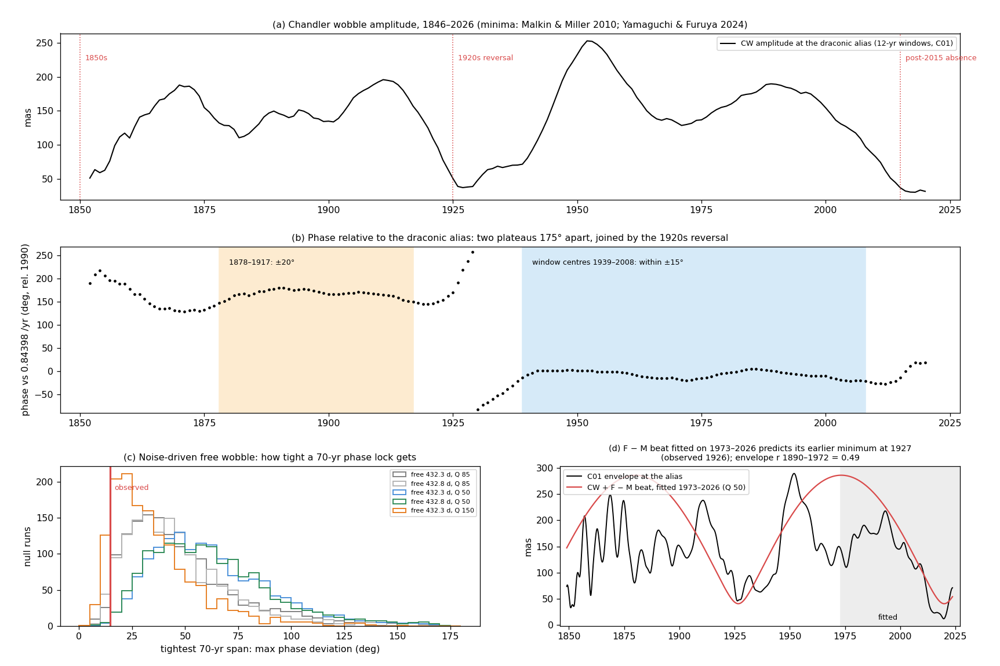

# Supplement: long-record phase coherence of the Chandler wobble, 1846–2026

*Supplement to [cw_synchronized_wobble.md](cw_synchronized_wobble.md), 2026-10-24. Code: `cw_longrecord.py`
(figure `cw_longrecord.png`, numbers `cw_longrecord.json`). Data: IERS EOP C01, 1846–2026 (`fetch_eop.py`; 0.1-yr
sampling to 1890, 0.05 yr after).*

**Had this been done?** Yamaguchi & Furuya (2024, *Earth Planets Space* 76:1, Fig. 1c) extended the CW back to 1890
with EOP C01:
- **Their method:** they fit 2015–2021 polar motion with the annual wobble and a drift only, extrapolated back, and
  took the difference as the CW, assuming no Chandler period or Q.
- **What they used it for:** to confirm the small CW of the 1920–40s and to date the recent absence.
- **What it was not used for:** testing whether the CW's phase stays locked to a particular forcing frequency over
  the long record. The present supplement does that, using the draconic alias fixed in advance:
  f_CW = 2 × 365.2422/27.212221 − 26 = 0.84398 /yr (432.8 d).

## Method

Complex polar motion p = x − iy is fitted in sliding 12-yr windows, stepped by 1 yr. Each window contains a prograde
line at the fixed alias f_CW, prograde and retrograde annual and semiannual lines, and a quadratic drift. The CW's
amplitude and phase are then read relative to the alias:
- **A forced line at f_CW** gives a flat phase.
- **A free mode driven by noise** gives a wandering phase. Its phase decorrelates over Q/(π f₀) years (about 20–55 yr
  for Q = 50–150).

## Results

**Two long phase plateaus, 175° apart** (panel b; years are window centres):

| span | phase relative to the alias | CW amplitude |
|---|---|---|
| **1878–1917** (40 yr) | within ±20° | 110–195 mas |
| 1918–1938 | reverses by ~175° | minimum ≈ 37 mas around 1926–28 |
| **1939–2008** (70 yr) | **within ±14.5°** | 62–253 mas |
| 2009–2020 | +40° excursion | falls to ≈ 31 mas (the post-2015 absence) |
| 1852–1877 | 190° → 130° (the 1850s jump of Malkin & Miller) | minimum ≈ 50 mas in the early 1850s |

- **The lock frequency.** A forced line holds phase only relative to its own frequency. The 70-yr plateau is tightest
  for reference frequencies 0.8435–0.8440 /yr (±14–14.5°), against ±24° for the consensus free period 432.3 d. The
  single coherent frequency over 1926–2026 is 0.84445 /yr. Malkin & Miller's 163-yr main period, 1.185 yr, is
  0.8439 /yr. All agree with the alias 0.84398 to within the record's resolution. They do not exclude 433.0 d (the
  plateau is as tight there), but the alias is fixed in advance from the lunar elements.
- **Reversals coincide with amplitude minima.** The jumps fall at the amplitude minima (1850s, 1920s, 2010s),
  matching the published jump dates (Orlov 1944; Guinot 1972; Vondrák 1988; Malkin & Miller 2010). Between them, the
  phase is locked.

**Against a noise-driven free wobble.** Simulated on the same time grid and analysed identically, 1,500 runs each.
The search over all 70-yr spans in each run is included:

| null: free mode | median tightest 70-yr span | P(70-yr span ≤ 14.5°) | P(both plateaus as tight) | P(both, ≥ 150° apart) |
|---|---|---|---|---|
| 432.3 d, Q = 85 | 42° | 0.022 | 0.007 | < 0.0007 (0 of 1500) |
| 432.8 d (the alias itself), Q = 85 | 41° | 0.027 | 0.007 | 0.0007 |
| 432.3 d, Q = 50 | 57° | 0.003 | < 0.0007 | < 0.0007 |
| 432.8 d, Q = 50 | 58° | 0.003 | 0.0007 | < 0.0007 |
| 432.3 d, Q = 150 | 30° | 0.094 | 0.056 | 0.0013 |

- **The 70-yr lock alone is rare** for Q ≤ 85 (p = 0.003–0.03).
- **The full pattern is rarer.** Two long locks separated by a ~180° reversal occurs in at most 2 of 1,500 runs for
  any Q tested (p ≤ 0.0013), including a free mode placed exactly at the alias. At the Q ≈ 50 preferred by Yamaguchi &
  Furuya, none of 1,500 reproduce it.
- **A forced line explains it naturally:**
  - phase locked to the forcing while the forcing holds;
  - a sign flip of the effective forcing, or a passage through zero of two beating forced lines, gives a ~180° jump
    at an amplitude minimum.

**The F − M beat, out of sample.** The CW + F − M two-line forcing ([cw_suppression.md §6](cw_suppression.md)) was
fitted only on 1973–2026. Extrapolated back:

| fit | predicted earlier minimum | observed C01 minimum | envelope correlation 1890–1972 |
|---|---|---|---|
| Q = 85 | 1922.9 | 1926.3 | 0.42 |
| Q = 50 | **1926.7** | **1926.3** | 0.49 |
| Q = 32 | 1927.1 | 1926.3 | 0.50 |

- **The timing:** the beat, fitted after 1973, places the 1920s minimum within a year at Q = 50.
- **The envelope:** its correlation over 1890–1972 is 0.42–0.50, against 0.22 when checked earlier against
  `cw.dat`, which lacked 1890–1934.
- **What it misses:** the 1850s jump and the 1950s maximum (panel d), so other factors act on top.

## What this adds

- **Strengthened:**
  - the CW holds its phase relative to the draconic alias for 70 years (and 40 years before the 1920s);
  - the phase reverses only at amplitude minima;
  - the reversals' timing is reproduced, out of sample, by the beat of the alias with the lunar F − M (6-year) line.
- **Against the consensus model:** none of this is typical of a noise-driven free mode. That model would need an
  unusually high Q (≥ 150) to approach the single 70-yr lock, and even then reproduces the lock–reversal–lock pattern
  in about 0.1% of runs.

**Caveats:**
- The 12-yr windows smooth the phase; shorter windows are noisier, especially before 1900, where C01 errors exceed
  50 mas.
- The null is a single damped mode with white excitation. Excitation that is coloured but smooth across the narrow
  Chandler band behaves the same.
- The plateau test cannot separate the alias (432.8 d) from 433.0 d. The alias is preferred because it was fixed in
  advance, and because the F − M timing test depends on it.
