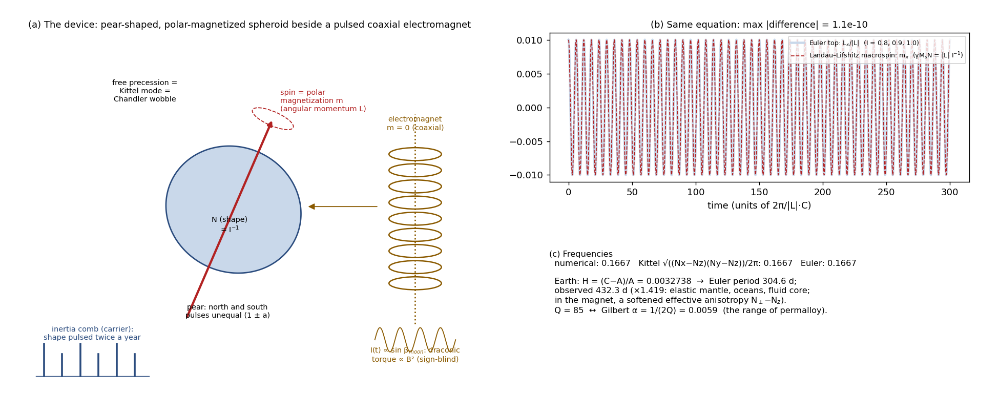
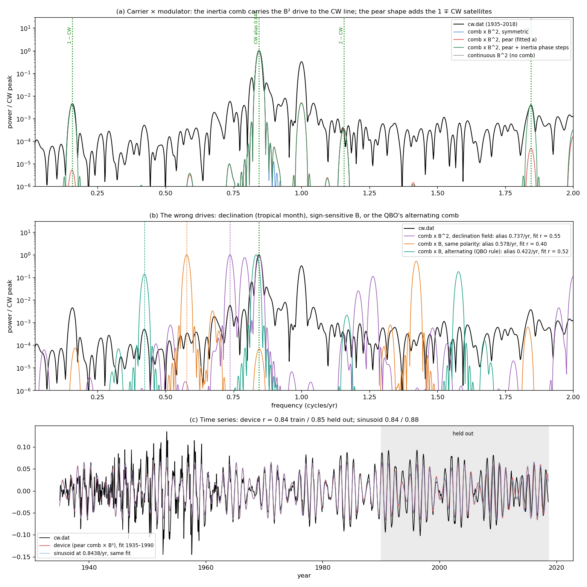

# The device: a polar-magnetized spheroid, a pulsed electromagnet, and the alias rule

*Appendix to [cw_synchronized_wobble.md](cw_synchronized_wobble.md), reconciled 2026-10-23. It sets out the first
version of the device: sharp kicks at the comb instants, with the free mode fixed at 432.3 d and Q = 85. The
reconciled device gates the torque through push-pull pulses about 5.5 days wide and leaves f₀ and Q free (lead
§2–3). The data analysis that used to be in this document, with its corrections, is in
[cw_data_tests.md](cw_data_tests.md).*

Code: `cw_magnetized_spheroid.py`. Figures: `cw_spheroid_equivalence.png`, `cw_spheroid_spectra.png`. Numbers:
`cw_magnetized_spheroid.json`.

## 1. A mathematical identity for the free mode

Euler's equation for a free rigid body, dL/dt = L × (I⁻¹L), is the Landau–Lifshitz equation for a uniformly magnetized
ellipsoid, dm/dt = γM_s m × (N m), under m = L/|L| and γM_s N = |L| I⁻¹. The shape tensor N plays the inverse inertia
tensor.

| rotating Earth | magnetized spheroid |
|---|---|
| spin angular momentum L, nearly polar | magnetization m, polar |
| inverse inertia tensor I⁻¹ | shape (demagnetizing) tensor N |
| free Eulerian nutation (polar motion) | uniform (k = 0) Kittel precession |
| Euler: σ = Ω √((C−A)(C−B)/(AB)) | Kittel: ω = γM_s √((N_x−N_z)(N_y−N_z)) |
| damping, Q | Gilbert damping α = 1/(2Q) |

- **Numerical check:** a triaxial top and its mapped macrospin agree to 1.1 × 10⁻¹⁰ over 50 periods (panel b).
- **Earth's numbers:** (C−A)/A = 0.0032738 gives a rigid Euler period of 304.6 d. The observed CW is about 433 d.
- **Where the identity stops mattering:** the argument does not depend on this formula. A forced wobble's natural
  frequency is fitted, not assumed (lead §3).
- **The working analog:** rotating electromagnetic machinery (lead §1). The nanomagnet stays as an identity only.

The pear shape, a north–south (degree-3) asymmetry, does not enter the free frequency, which depends only on second
moments. It enters through the forcing, as unequal north and south pulses.

## 2. The first device

| Earth | device | code |
|---|---|---|
| the Moon's ecliptic latitude β (draconic month 27.2122 d) | coaxial (wavenumber 0) electromagnet, current ∝ sin β | `field(t, "beta")`, Meeus elements (astronomical phase) |
| tidal torque on the bulge, blind to the perturber's sign | torque ∝ B² on an induced, shape-anisotropic moment | kick ∝ B² |
| seasonal mass redistribution, twice a year | shape (inertia) pulsed twice a year: the carrier comb | `comb_times(t0)` |
| unequal hemispheres | pear: alternate pulses 1 ± a | `kicks(t0, a)` |
| polar motion p | transverse magnetization m_x + i m_y | `response_linear`, `response_llg` |

The torque reaches the mode only during the pulses: Δθ_n = s · w_n · B(t_n)². This is the impulse map of
`../cw_physics.py`. A full nonlinear Landau–Lifshitz–Gilbert integration at the realistic amplitude (about 1 µrad)
agrees with the linear propagator to 0.6%.

**What the reconciled device changes** (lead §2–3):
- **The torque is gated through each pulse, not sampled at an instant.** The pulse window averages the fortnightly
  torque, so its spectrum weights each comb harmonic.
- **The pulses are push-pull** (the coupling follows the rate of inertia change) and about 5.5 d rms.
- **The distance factor (a/r)³ is included,** which makes the Mm line.
- **f₀ and Q are free,** not fixed at 432.3 d and Q = 85.
- **The annual wobble has its own seasonal excitation.**

## 3. The alias rule: one table for the QBO and the CW

A same-polarity semiannual comb has harmonics at even integers (cycles/yr); an alternating-polarity comb at odd
integers. A drive line folds to its distance from the nearest harmonic:

| lunar month | B, same comb | B, alternating comb | B², same comb | B², alternating |
|---|---|---|---|---|
| **draconic** 27.2122 d | 0.578 | **0.422 (2.370 yr) = QBO** | **0.844 (432.8 d) = CW** | 0.156 |
| tropical 27.3216 d | 0.632 | 0.368 | 0.737 | 0.264 |
| **anomalistic** 27.5545 d | **0.745 = Mm** (distance, (a/r)³) | 0.255 | 0.511 | 0.490 |
| synodic 29.5306 d | 0.368 | 0.632 | 0.737 | 0.264 |

- **The QBO:** a wind has a direction, so the drive enters linearly and the solar declination flips the comb's
  polarity.
- **The CW:** an axis has no head or tail, so the drive enters squared on a same-polarity comb.
- **Why the draconic month:** only it gives either observed line. The drive is referenced to the ecliptic, the plane
  that sets the comb.
- **The 0.74 /yr peak:** the anomalistic month's distance modulation is a one-signed factor, so it enters linearly on
  the same comb and gives Mm at 0.7448. The tropical B² alias (0.7365) lies within the resolution, but the raw data
  pick 0.748 and a stationary phase at Mm ([cw_data_tests.md §4](cw_data_tests.md)).

## 4. First device fits, against `cw.dat`

Two timing parameters (comb day, asymmetry a) were fitted on 1935–1990, with 1990–2018 held out. Linear terms set the
amplitude, projection, constant and annual. Here r is the time-series correlation; "1 ∓ CW" is the side-peak power
relative to the CW:

| variant | strongest line 0.45–0.95 | 1 ∓ CW | train r | held-out r |
|---|---|---|---|---|
| continuous B² torque, no comb | (CW power 6 × 10⁻¹⁰ of the comb case) | — | 0.48 | 0.53 |
| comb × B², symmetric | 0.844 | < 10⁻⁷ | 0.840 | 0.853 |
| comb × B², pear | 0.844 | 5 × 10⁻⁶ – 5 × 10⁻⁵ | 0.841 | 0.853 |
| comb × B², declination (tropical) | 0.737 | — | 0.55 | 0.69 |
| comb × B, same polarity | 0.578 | — | 0.40 | 0.61 |
| comb × B, alternating (QBO rule) | 0.422 | — | 0.52 | 0.25 |
| *sinusoid at 0.8440* | 0.844 | — | 0.840 | 0.877 |
| `cw.dat` | 0.843 | 4 × 10⁻³ (processing; [cw_data_tests.md §2](cw_data_tests.md)) | | |

**What still holds:**
- **The comb is necessary:** without it the B² torque leaves no CW line.
- **The CW period is a prediction:** 432.8 d, from the draconic month and the B², same-polarity rule.
- **The other months and rules fail:** they put the line at 0.42–0.74 /yr and fit far worse (r = 0.40–0.55).

**What does not:**
- **The side peaks:** `cw.dat`'s 1 ∓ CW peaks are not Earth signals, so the pear shape's role in them is moot.
- **The time domain:** the device is no better than a sinusoid at the predicted frequency. This also holds for the
  reconciled device on raw data (lead, essential fit).
- **The comb date:** it is not identifiable. With the CW alone it repeats every 13.6 d (the B² period); with Mm
  included, every ~27 d.

## 5. Laboratory analogs

The dialog (`../dialog.pdf`) concluded that no controlled experiment could test aliased lunar forcing. Two
macroscopic rigs could:
- **A rotor on active magnetic bearings.** Gyroscopic forward and backward whirl; electromagnet actuators driven by
  switched amplifiers under a sampled controller. A fast force modulation gated by a slow pulse train should lock the
  whirl at |f_mod − k·f_pulse|, with the modulation's phase.
- **An inverter-fed drive under slow sampled control.** Shaft torsional resonance; a fast torque ripple (cogging)
  sampled by the controller. This is the same alias rule, in one dimension.

The nanomagnet version (Kittel mode at GHz, voltage-controlled anisotropy pulses) also follows from §1. It is
microscopic, though, and needs pulsed anisotropy at GHz rates, so it is listed only for completeness.
