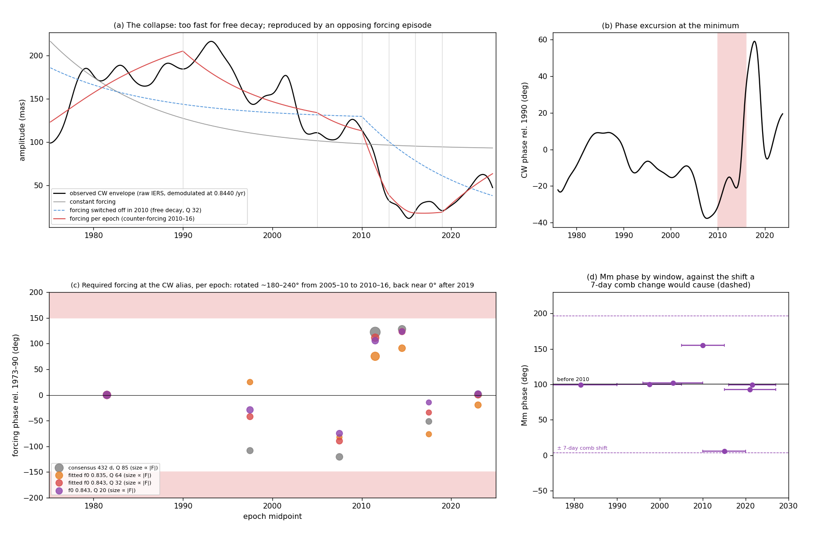

# Supplement: could a counter-torque have suppressed the Chandler wobble after 2010?

*Supplement to [cw_synchronized_wobble.md](cw_synchronized_wobble.md), 2026-10-24. Code: `cw_suppression.py`
(figure `cw_suppression.png`, numbers `cw_suppression.json`). Data: raw IERS daily polar motion, 1973–2026
(`fetch_eop.py`), and `../cw.dat` for 1935–1972.*

**The question.** In the forced-wobble picture, the CW is sustained by a small fraction of the lunar torque arriving
at the alias frequency: about 2 × 10⁻⁴ (consensus resonance) to 5.5 × 10⁻⁴ (fitted bandpasses) of the peak lunar
torque on the bulge. Could a related torque of the same small size, pointing the other way, have suppressed the wobble
as observed in the last decade?

## The cited study

Yamaguchi, R. and Furuya, M. (2024), "Can we explain the post-2015 absence of the Chandler wobble?", *Earth, Planets
and Space* 76:1, doi:10.1186/s40623-023-01944-y (open access, CC BY 4.0).

- **The observation.** They fit 2015–2021 polar motion with only the annual wobble and a quadratic drift, then
  extrapolate back. The CW "started to be weaker in 2005 and became insignificant in 2015". The 6-year CW/annual
  beat, visible even in the 1920–40s minimum (EOP C01 back to 1890), is absent after 2015.
- **Q.** Re-integrating the geodetic excitation for assumed P and Q, they find P ≈ 432 d and Q "unlikely to be
  greater than 100", indeed "below 50". Q ≈ 25 matches the post-2015 period but is "too low to account for the CW in
  the 1980–2000s".
- **Excitation.** Three independent atmospheric angular-momentum series (ECMWF, NCEP, JRA-55) agree with one another
  and give "persistently smaller amplitude since 2015". The ocean series disagree with each other and do not change;
  land water would even enlarge the recent CW.
- **Interpretation.** Random excitation would make the absence "simply fortuitous by chance". Instead, "the CW absence
  may be interpreted as an abrupt termination of" near-resonant processes: quasi-periodic ~14-month excitation in
  the atmosphere, possibly the ocean.
- **The QBO.** They tie the smaller atmospheric excitation to the unprecedented disruptions of the equatorial QBO in
  2015/16 and 2019/20, through the meridional part of the atmospheric angular-momentum budget.

The present supplement tests the same anomaly with the forced-wobble device. It asks what forcing at the alias the
observed wobble required, and whether that forcing reversed.

## 1. What happened

The CW, demodulated at the alias (0.8440 /yr) from raw polar motion with the annual, semiannual, Mm lines and trend
removed:

| year | 1993 | 2000 | 2005 | 2010 | 2012 | 2014 | 2016 | 2018 | 2020 | 2022 |
|---|---|---|---|---|---|---|---|---|---|---|
| amplitude (mas) | ≈ 215 | ≈ 155 | ≈ 115 | ≈ 112 | ≈ 64 | ≈ 25 | ≈ 15–20 | ≈ 30 | ≈ 28 | ≈ 45 (edge) |

- **Onset and collapse:** the decline starts by 2005, as the paper finds, and becomes a collapse in 2010–2014.
- **Phase:** it stayed within about ±30° of its 1990 value until 2014. It then swung by about +80° (peak 2017–18) and
  returned by 2020 (panel b).
- **No reversal:** the wobble passed near zero and regrew with roughly its old phase.

## 2. Too fast to be a free decay

From 2010 to 2014 the amplitude fell from 112 to 25 mas, an e-folding time of 2.6 years. If the forcing had merely
stopped, the wobble would decay freely with e-folding time Q/(π f₀):

| Q | free e-folding time | can free decay match the 2010–14 drop? |
|---|---|---|
| 85 | 32 yr | no |
| 50 (Yamaguchi & Furuya) | 19 yr | no |
| 32 (lowest the line set allows) | 12 yr | no |
| **≈ 7** | 2.6 yr | needed |

- **Stopping the forcing is not enough.** A free decay this fast needs Q ≈ 7. The paper's re-integration (Q ≤ 50,
  with Q ≈ 25 fitting post-2015) and the 2 − CW bound here (Q ≳ 30) both rule that out.
- **What the paper's method already contains.** Re-integrating the geodetic excitation includes whatever happened to
  the excitation, so its Q is consistent with an excitation that actively changed.
- **Fitted to the envelope,** a forcing switched off in 2010 leaves 48–55 mas of residual, little better than a
  constant forcing (53–66 mas).

## 3. The forcing the wobble required, epoch by epoch

In the frame rotating at the alias, dz/dt = a·z + F(t), with a = i2π(f₀ − f_CW) − πf₀/Q. F was fitted as constant over
epochs, solving the equation exactly, by linear least squares on the envelope. The residual drops to 23–25 mas for
every Q. The table gives the required forcing relative to 1973–1990 (magnitude / phase):

| epoch | Q = 85 (432 d) | Q = 64 (437 d) | Q = 32 (433 d) | Q = 20 |
|---|---|---|---|---|
| 1990–2005 | 0.49 / −108° | 0.27 / +25° | 0.46 / −42° | 0.60 / −29° |
| 2005–2010 | 0.65 / −121° | 0.19 / −82° | 0.45 / −90° | 0.47 / −75° |
| **2010–2013** | **2.31 / +122°** | **1.44 / +75°** | **1.04 / +111°** | **0.62 / +105°** |
| **2013–2016** | **0.98 / +128°** | **0.67 / +91°** | **0.51 / +123°** | **0.34 / +123°** |
| 2016–2019 | 0.36 / −52° | 0.19 / −76° | 0.18 / −34° | 0.13 / −15° |
| 2019–2027 | 0.87 / +1° | 0.53 / −20° | 0.56 / 0° | 0.46 / +2° |

- **Reversal, then quiet, then recovery.** For every Q, the forcing swings by about 160–240° between 2005–10 and
  2010–16: a counter-forcing of roughly the sustaining size. It nearly vanishes in 2016–19 (the period of the first
  QBO disruption). It resumes near its original phase at about half strength after 2019.
- **Caveat.** The epoch model has seven complex forcing values, so it describes the history; §6 tests simpler
  alternatives.

## 4. How big a counter-torque?

The 2010–16 forcing is 0.3–2.3 times the 1973–90 sustaining level. With the sustaining counter-torques of lead §5
(5.9 × 10¹⁸ N·m at the consensus resonance, 1.3–1.6 × 10¹⁹ N·m for the fitted bandpasses), the opposing episode needs
about 0.5–1.5 × 10¹⁹ N·m. That is 2–5 × 10⁻⁴ of the peak lunar torque on the bulge (2.9 × 10²² N·m). In magnitude, a
counter-torque that suppresses the CW for a few years is exactly as plausible as the forcing that sustains it.

## 5. A counter-torque without a new torque: the seasonal comb

The CW forcing is the lunar torque gated by the seasonal inertia pulses and read at comb harmonic 26. High harmonics
are sensitive to the comb's details:

| change in the seasonal pulses | CW forcing (harmonic 26) | Mm (harmonic 14) | QBO alias (F, harmonic 13) | semiannual (harmonic 2) |
|---|---|---|---|---|
| timing shifted by 7 days | rotated 179°, i.e. reversed | rotated 97° | rotated 90° | rotated 14° |
| width increased 25% (5.5 → 7 d rms) | reduced to about 15% | reduced to about 58% | — | essentially unchanged |

**What Mm did.** By window, raw p (Mm phase / Mm amplitude; then the CW amplitude):

| window | 1973–90 | 1990–2005 | 1996–2010 | 2005–15 | **2010–20** | 2015–27 | 2016–27 |
|---|---|---|---|---|---|---|---|
| Mm | 99° / 9 mas | 100° / 17 | 102° / 18 | 155° / 31 | **6° / 11** | 93° / 19 | 99° / 22 |
| CW (mas) | 159 | 169 | 132 | 89 | 34 | 33 | 37 |

- **Phase:** in the window centred on the episode, Mm's phase moved by about −95°, the size a 7-day timing shift
  predicts.
- **Amplitude:** Mm was not suppressed, which favours a timing change over a broadening.
- **Caveats:** the overlapping 2005–15 window shows +55° instead, and 10-year windows only just separate Mm from the
  CW.

**The link to the QBO.** The CW and the QBO share the comb in this framework:
- **CW:** sign-blind drive (B²) on a same-polarity comb.
- **QBO:** sign-sensitive drive (B) on an alternating comb (`gem-lte-core/docs/qbo_tokamak.md`).

A change in the seasonal comb therefore perturbs both at once. The QBO device stays phase-locked to 2005 but cannot
follow the post-2006 phase slips or the 2016 and 2019–20 disruptions. The paper ties the CW's lost atmospheric
excitation to those same disruptions. A week-scale change in the timing of the seasonal mass transfer would:
- reverse the CW forcing;
- rotate the QBO's alias forcing by about 90°;
- rotate Mm by about 97°.

That is one cause for three anomalies in the same decade, and it is testable (§8).

## 6. Steady lines instead of an episode: beats near the CW

A slowly varying CW envelope can also come from two steady forced lines beating, with no episode at all. A second
line near the CW needs a source, and two lunar candidates fall nearby. Both sit on odd comb harmonics, so both need an
annual impulse (unequal semiannual pulses). An opposing semiannual pulse of equal size cancels every odd harmonic and
breaks them, as with the Mt term in the AMO model.

| second line | origin | beat period with the CW | envelope rms, 1973–2026 | fitted second-line size | beat minima | out-of-sample (`cw.dat` 1938–72) |
|---|---|---|---|---|---|---|
| **2F + M**, 0.9008 /yr | 40.0991 /yr on harmonic 41 (complement of 2F − M) | 17.6 yr | 53–61 mas (no better than constant forcing) | 4–8 mas | 1934, 1951, 1969, 1986, 2004, 2022 | r ≈ −0.3 (line too weak to matter) |
| **F − M**, 0.8332 /yr | 0.1666 /yr, the 6-year cycle (perigee − node), on harmonic 1 | 93 yr | 30–33 mas | 104–186 mas | **1924–29, 2017–22** | r = 0.20–0.27; misses the ~1967 minimum |
| best free second line | scan 0.70–1.00 | — | 28–31 mas, at 0.823–0.830 /yr | comparable to the CW line | — | — |
| seven forcing epochs (§3) | — | — | 23–25 mas | — | — | — |

- **2F + M as a long-term counter-modulation.** Its 17.6-yr beat phase places minima near 1934 and 1969, two of the
  historical CW lows. Its fitted steady size is small, though, and in the gated device harmonic 41 is strongly
  suppressed by a ~5.5-day pulse. If it acts only while an annual impulse is present (and is broken by a balancing
  semiannual pulse), a constant-line fit would miss it. An intermittent-line test, with the N/S balance as a
  switch, is needed before ruling it in or out.
- **F − M does better as a steady beat.** Fitted only on 1973–2026, it puts deep minima in the 1920s (the known
  1920–40s minimum) and in 2017–22 (the present absence). It needs the annual impulse too, and is linear in the
  ecliptic latitude, the QBO-type drive. But it predicts a maximum where `cw.dat` has the deep 1965–70 minimum, so a
  single steady beat is not the whole story.
- **The two readings are not exclusive.** A steady F − M beat would set a slow (~90-yr) envelope. Episodes such as
  2010–16, and the 17.6-yr 2F + M modulation if its annual impulse is present, would add faster changes on top.

### 6.1 The F − M line is the Earth's 6-year cycle

The F − M frequency, draconic minus anomalistic (equivalently the lunar perigee minus node), is 0.16675 /yr, a
**5.997-year** period. A 6-year cycle is long known in length of day and polar motion, and has recently been found
across the core, gravity field and climate. Cazenave, A., Pfeffer, J., Mandea, M., Dehant, V. and Gillet, N. (2025),
"Why is the Earth system oscillating at a 6-year period?", *Surveys in Geophysics* 46:503–528,
doi:10.1007/s10712-024-09874-4. The review's points:
- **Where it appears:** a 6-year cycle of about 0.1 ms in LOD; in polar motion (Chen et al. 2019), "close to the beat
  frequency … between the annual polar motion and the Chandler wobble"; in core flow and the magnetic field; in the
  ellipticity of the equator; and in atmospheric angular momentum, sea level and hydrology.
- **Period:** "some dispersion (up to ±1 year)" around 6 years.
- **Mechanism:** "yet to be identified". The external scenario considered is a ~5.9-yr Jupiter-driven orbital term.
  The Moon is not proposed.

**The beat arithmetic.** In polar motion the two 6-year-ish signals sit next to each other:

| signal | frequency (/yr) | period |
|---|---|---|
| F − M, the lunar 6-year cycle | 0.16675 | 5.997 yr |
| annual − CW, the classical "6-year beat" of polar motion | 1 − 0.8440 = 0.1560 | 6.41 yr |
| their difference: the envelope | 0.0107 | **≈ 93 yr** |

Folded by the annual impulse, F − M appears in polar motion at 1 − 0.1668 = 0.8332 /yr, beside the CW at 0.8440. The two
forced lines interfere with a ~93-year envelope. Fitted only on 1973–2026 (§6 table), that envelope has its minima in
the 1920s and around 2017–22: the historical CW minimum and the present absence. Its deep 1960s minimum is not
reproduced, so other factors (the 2010s-type episodes, or the 17.6-yr 2F + M modulation) still act on top.

**Is the 6-year cycle significant in LOD, and is it locked to F − M?** LOD is zonal (wavenumber 0) and should carry
F − M directly. Two tests on the raw IERS daily LOD, 1973–2026 (`cw_suppression.py`, item 5):

*Significance against red noise* (annual means, cubic trend and 18.6-yr term removed):

| test | result |
|---|---|
| strongest peak in the 4.5–8.5-yr band | at 8.0 yr, not 6; the 5.97-yr peak has 3% of the power of the dominant 12-yr peak |
| band peak over a power-law background | 1.7× (single-frequency p ≈ 0.19; after the 23 frequencies searched, p ≈ 0.99) |
| AR(1) / AR(2) noise with an equal or larger band peak | 57% / 72% |

**In raw LOD the 6-year cycle is not separable from red noise.** The published 6-year LOD signal (about 0.1 ms) comes
from residual LOD after the atmospheric angular momentum (dominated by ENSO in the interannual band) and the decadal
core signal are removed, from band-pass filtering, and from coherence across data sets. Without those steps, and with
only 53 years, it does not stand out. The review itself notes ±1-yr dispersion and an amplitude "not perfectly
constant with time".

*Phase against the lunar F − M angle* (0.05-yr LOD band-passed to 4.5–8.5 yr, regressed on F − M′ in three windows):

| window | amplitude locked to F − M′ | phase relative to the astronomical angle | correlation |
|---|---|---|---|
| 1973–1991 | 0.145 ms | −69° | 0.81 |
| 1991–2009 | 0.064 ms | −81° | 0.60 |
| 2009–2027 | 0.044 ms | +114° | 0.76 |
| whole record | 0.052 ms | −75° | 0.43 |

- **Band-passing makes any noise look sinusoidal.** AR(2) noise put through the same filter correlates with the
  F − M sinusoid at a median r ≈ 0.73 per window. So the correlations are not evidence.
- **Little remains.** Only the agreement of the first two windows within 13° is unusual (p ≈ 0.06 for noise), and
  the third window reverses.
- **So this test neither supports nor excludes** a lunar F − M component in LOD. An earlier draft read it as "locked
  for 36 years, then reversed"; that reading is withdrawn.
- **Decisive versions** would use AAM-corrected LOD and longer records (C04 from 1962; LOD back to the 1830s).

The case for F − M therefore rests on polar motion (§6.2), not on LOD.

### 6.2 Commensurability with the year, and the 1920s reversal

**The 1920s reversal (checked).** A CW phase jump of about 180° in the 1920s, at a deep amplitude minimum, is well
established: first detected by Orlov (1944) and analysed by Guinot (1972) and Vondrák (1988). Malkin, Z. and Miller,
N. (2010), "Chandler wobble: two more large phase jumps revealed", *Earth, Planets and Space* 62:943
(arXiv:0908.3732), studied 163 years of IERS pole coordinates:
- **Minima:** the CW amplitude falls below 0.05″ around 1850, 1925 and 2005.
- **Phase jumps:** large jumps in the 1850s and 2000s as well as the 1920s, each "contemporarily with a sharp decrease
  in the CW amplitude".
- **Spacing:** 1925 + 93 = 2018, inside the post-2015 absence. The 1850s event is 75 years before 1925, so it does not
  fit a 93-year spacing.

**Commensurability: an assist every sixth year.** F − M = 0.16675 /yr is almost exactly 1/6: the perigee–node cycle
is 5.997 yr, drifting only about 1.1 days per six years. Sampled by an annual comb, the lunar perigee–node geometry
therefore recurs at nearly the same seasonal phase every sixth year: a reliable, cumulative assist. In frequency,
F − M and its comb aliases land almost exactly on multiples of 1/6 /yr:

| alias | frequency (/yr) | where it appears |
|---|---|---|
| F − M itself (harmonic 0) | 0.1668 (6.0 yr) | the reported 6-year LOD cycle (not significant in raw LOD, §6.1) |
| 1 − (F − M) | 0.8332 ≈ 5/6 | beside the CW (0.8440): the ~93-yr envelope |
| 1 + (F − M) | 1.1668 ≈ 7/6 | a steady line in raw polar motion (below) |

**The 7/6 line is real and steady.** In raw complex polar motion, four 13.5-yr windows (amplitude in mas, phase):

| line | 1973–86 | 1986–2000 | 2000–13 | 2013–27 | phase spread | best-fit frequency 1.14–1.19 |
|---|---|---|---|---|---|---|
| **1 + (F − M) = 1.1668** | 2.5 | 1.4 | 11.5 | 6.3 | **±31°** | **1.163** |
| 2 − CW = 1.1560 | 1.7 | 1.8 | 13.9 | 6.7 | ±113° | |

- **Correction:** the peak near 1.16, earlier read as the draconic comb partner 2 − CW, is better identified as
  F − M on the annual harmonic. It is phase-steady (a ±31° spread has p ≈ 0.01 for random phases), whereas 2 − CW
  wanders.
- **Timing:** its amplitude rose after 2000, as the CW declined.

**Phase jumps at the beat minima.** Two forced lines with amplitude ratio r beat. At each envelope minimum the
resultant's phase changes by about 2·arcsin(r): small for unequal lines, 180° for equal ones. The F − M two-line fits
(on 1973–2026 only) give:

| fit | F − M / CW line ratio | minima | phase jump across each minimum (±6 yr) |
|---|---|---|---|
| Q = 85 | 0.62 | 1924, 2017 | 59° |
| Q = 50 | 0.73 | 1927, 2020 | 83° |
| Q = 32 | 0.81 | 1927, 2021 | 102° |
| Q = 64 | 1.00 | 1929, 2022 | 156° |
| **observed** | | **≈ 1925 (Malkin & Miller); 2015–16 (§1)** | **≈ 180° (1920s); +33° to +45° net, +80° transient (2008–22)** |

- **Timing fits, out of sample.** Fitted only on data after 1973, the beat puts its earlier minimum at 1924–1929, on
  the 1920s reversal.
- **The 1920s:** a 180° jump with a deep minimum is what near-equal lines give.
- **The 2010s:** the minimum was as deep but the net jump smaller. Either the F − M line was relatively weaker then
  (its strength depends on the annual impulse, the N/S seasonal imbalance), or the 2010–16 counter-forcing of §3
  reshaped the passage.
- **The 1850s and 1960s minima** do not fall on the 93-yr beat and need other causes.

## 7. Verdict

| aspect | assessment |
|---|---|
| magnitude | **plausible:** the counter-torque needed (≈ 10¹⁹ N·m, a few × 10⁻⁴ of the peak lunar torque) equals the sustaining one |
| speed | **required:** the 2010–14 drop is 5–12× faster than free decay for Q = 32–85 (and for the paper's Q ≤ 50) |
| signature | **consistent:** the required forcing reverses (2010–16), goes quiet (2016–19) and resumes near its old phase; the wobble's phase makes an excursion at the minimum and recovers |
| mechanism | **open, with candidates:** (a) a ~1-week shift in the seasonal comb, which would also rotate Mm by ~97° and the QBO alias by ~90°; (b) a steady F − M beat (~93 yr) between the lunar 6-year cycle and the 6.4-yr annual–CW beat, which gets the 1920s reversal (out of sample) and the 2015–20 minimum but not the 1850s or 1960s ones; F − M ≈ 1/6 /yr gives a reliable assist every sixth year and its 7/6 alias is a steady line in raw polar motion (in raw LOD the 6-year cycle is not significant against red noise, so LOD neither supports nor excludes it); (c) a 2F + M counter-modulation (17.6 yr) that exists only while an annual impulse does |
| agreement with the paper | in substance: the excitation did not fade randomly. It changed coherently, in the atmosphere, in the decade of the QBO disruptions, and Q is moderate |

## 8. Tests

1. **Regrowth.** If the forcing stays at its post-2019 level (about half the 1973–90 level), the CW should regrow
   toward 85–100 mas, reaching roughly 70–80 mas by 2030 at Q ≈ 32. The F − M beat instead predicts slow regrowth
   over decades.
2. **Seasonal timing in the atmosphere.** In ERA5 or JRA-55 surface pressure, the timing and sharpness of the
   hemispheric seasonal mass transfer should shift by about a week around 2010–2016 relative to before and after.
   The JRA-55 angular-momentum series of the cited paper (Zenodo 10.5281/zenodo.7523914) is the natural starting
   point.
3. **Earlier minima.** In the IERS C01 series, the 1920s–40s minimum should show either the reversal-then-recovery
   signature in the required forcing (an episode) or a smooth F − M beat.
4. **Intermittent 2F + M.** Fit the 2F + M line with an amplitude proportional to the observed N/S (annual)
   asymmetry of the seasonal excitation, rather than as a constant line.
5. **The 6-year cycle, done properly.** Use AAM-corrected LOD (C04 from 1962, and long LOD series back to the 1830s)
   with a red-noise null. Is a 6.0-yr component significant, phase-locked to the lunar F − M angle, and did earlier
   changes coincide with CW minima?
6. **Mm and the QBO through 2010–2016.** A joint state-space track of the CW and Mm phases, and the QBO's
   alias-forcing phase from the QBO device, should all rotate together if the comb timing shifted.
