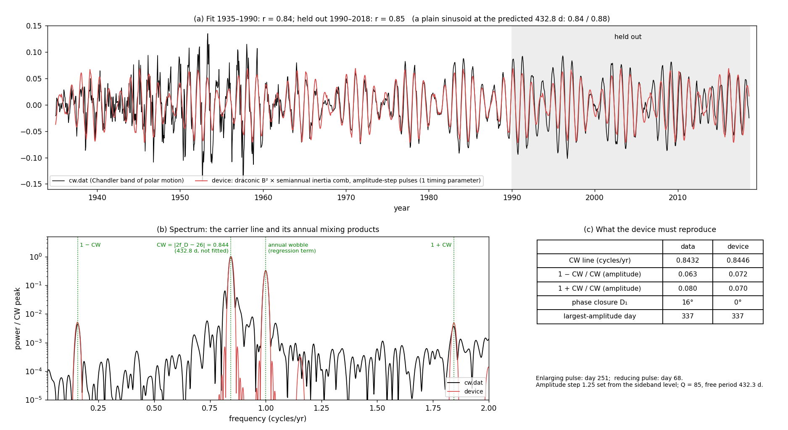

# The Chandler wobble as a rotational mode synchronized by an external cyclic torque

*Lead document, reconciled 2026-10-23. Data tests and their history: [cw_data_tests.md](cw_data_tests.md). The device
and the alias algebra in detail: [cw_magnetized_spheroid.md](cw_magnetized_spheroid.md).*

## The claim

The Chandler wobble (CW) is a rotational mode of the Earth whose phase is set by an external, cyclic, lunar torque. It
is not a free ring-down that random excitation restarts. Two features make the Earth's case unusual:
1. **The torque reaches the mode only during impulsive, twice-yearly changes in the moment of inertia** (the seasonal
   mass shift). These pulses form a comb.
2. **The comb samples a fortnightly torque**, so the CW sits at an alias: |2 × draconic − 26| = 0.8440 /yr (432.8 d).

Everything else is familiar from rotating machinery, where a mode synchronized to an external periodic torque is
routine.

*The essential fit (`cw_flagship.py`), on raw IERS polar motion. One timing parameter is fitted, on 1973–2000;
2000–2026 is held out.*
- *The forcing is astronomical: the Moon's ecliptic latitude squared times (a/r)³.*
- *It is gated by push-pull seasonal inertia pulses about 5.5 days wide (rms).*
- *The response is one prograde mode at f₀ = 0.843 /yr with Q = 32, the lowest Q the line set allows (§3).*
- *The annual wobble has its own seasonal excitation.*
- *CW, Mm, annual, the 2 − CW sideband and (within 2×) the semiannual line emerge at about their observed strengths.*
- *Held out, the Chandler band correlates at r = 0.75, the same as a fixed sinusoid at the CW frequency. The time
  domain does not discriminate. The evidence is in the line structure and the phase locks.*

## 1. Synchronization by an external cyclic torque is ordinary

A mode's exact natural frequency is not the point. A mode selects, from the many lines of a periodic forcing, the
one that falls near it, and then follows that line's phase. Rotating electromagnetic systems show this in many forms:

| system | rotational mode | external cyclic torque | what is synchronized |
|---|---|---|---|
| synchronous machine | rotor-angle swing ("hunting") | grid electrical torque; pulsating loads | rotor angle locks to the supply; pulsating torque drives the swing mode at the forcing frequency |
| tokamak | rotating tearing / locked modes | static or rotating error fields | the mode's rotation phase-locks to the error field once the electromagnetic torque exceeds the viscous restoring torque |
| rotor on active magnetic bearings | forward and backward whirl | electromagnet forces from switched amplifiers under sampled control | whirl follows the synchronous (unbalance) forcing; unbalance-rejection control cancels it |
| spin-stabilized spacecraft | nutation (the vehicle's free Euler wobble) | pulsed thruster firings | timed pulses pump or damp the nutation (active nutation control) |
| inverter-fed drive, asynchronous PWM or slow sampled control | shaft torsional resonance | carrier comb × modulating wave | lines at \|m·f_carrier − n·f_mod\| near zero become subharmonic torques that excite the resonance |
| generator on a series-compensated line | shaft torsional modes | electrical torque at a difference frequency | a mixing torque drives a mechanical mode (subsynchronous resonance, early 1970s shaft failures) |

The Earth combines the spacecraft and the drive rows:
- **Nutation forced by pulses:** the CW is the Earth's free Euler wobble, i.e. its nutation.
- **A comb sampling a fast modulation:** the twice-yearly inertia pulses sample the fortnightly lunar torque.

The pulses are the idiosyncrasy. They are not thruster firings but impulsive changes in the moment of inertia, and
the lunar torque on the bulge couples into the transverse mode while they last.

## 2. The idiosyncrasy: a pulsed inertia comb, and aliasing

A comb with pulses twice a year has harmonics at every even number of cycles per year (odd ones too, if the two
seasons are unequal). A torque line at frequency f appears at |f − k| for comb harmonic k. With a sign-blind torque
(∝ B²; the bulge is torqued the same way whichever side the Moon is on):

| lunar term (wavenumber 0) | torque line | comb harmonic | alias | raw polar motion, 1973–2026 |
|---|---|---|---|---|
| draconic latitude, squared | 26.8438 /yr | 26 | **0.8440 = CW** | 0.8435 /yr; phase-locked ±18–22° |
| anomalistic distance, (a/r)³ | 13.2553 /yr | 14 | **0.7448 = Mm** | 0.748 /yr; steady 18–26 mas, phase ±34° |
| draconic, next harmonic | 26.8438 | 28 | 1.1560 (2 − CW) | ~4 mas, phase wanders (the nearby steady peak is F − M at 7/6, [supplement §6.2](cw_suppression.md)) |
| perigee − node, F − M (the 6-year cycle) | 0.16675 /yr ≈ 1/6 | 0, ±1 | 1/6, 5/6, 7/6 | 6-yr LOD cycle; ~93-yr envelope with the CW; steady 7/6 line |
| the comb itself (mean torque) | 0 | 2 | 2.0 (semiannual) | 2.5 mas, steady (the contingency line) |

With a sign-sensitive drive and an alternating comb, the same folding rule gives the QBO's 2.370 yr
(`gem-lte-core/docs/qbo_tokamak.md`). The CW and the QBO are one sampled-data mechanism with two output symmetries.

**Pulse shape matters, and it is a gate.** The torque acts through each pulse's duration, so the pulse window averages
the fortnightly torque, and its spectrum weights each comb harmonic. The line set (§3) prefers push-pull pulses, in
which the coupling follows the rate of change of inertia, about 5.5 days rms. Such pulses suppress the low harmonic
(the semiannual) and the high ones (CW at 26, 2 − CW at 28) relative to Mm's harmonic 14.

## 3. A bandpass without consensus constraints

High Q was required only to keep a free wobble ringing between random kicks. A forced wobble needs no such Q, and its
natural frequency f₀ need not equal the observed CW frequency: if the line is forced, the peak marks the forcing, not
the mode. So f₀, Q, the pulse shape and the north/south asymmetry are all left free and fitted to the raw line set
(`cw_bandpass.py`). The annual line also has its own seasonal-loading excitation. The mass shift has a sign (north,
then south), so its direct effect alternates and feeds the odd harmonics.

| line (prograde, mas) | observed | fitted bandpass | consensus (432.3 d, Q = 85) |
|---|---|---|---|
| CW | 117.5 | 117.5 | 117.5 |
| Mm | 12.5 | 12.5 | 11.1 |
| annual | 92.0 | 92.0 | 92.0 |
| semiannual | 2.5 | 2.5 | 2.8 |
| 2 − CW (noise-limited) | ≤ ~4 | 3.2 | 1.0 |

What the data actually constrain:
- **Q ≳ 30, not ≳ 85.** The bound comes from the 2 − CW line. It shares the CW's forcing on the adjacent comb
  harmonic, so only the bandpass can keep it weak: Q = 10 predicts 13 mas, Q = 5 predicts 28 mas, against ≤ ~4
  observed. From Q ≈ 30 to 300 everything fits equally.
- **f₀ ≈ 0.83–0.86 /yr (425–440 d).** The mode is near, but not necessarily at, the forced line.
- **Pulses ≈ 5–6 d rms, push-pull.** Sharp one-way pulses fit worse: they need f₀ ≈ 448 d and still under-predict Mm.
- **Mm's strength is explained.** The distance modulation, (a/r)³ = ±16.5% from the orbital eccentricity (±19.5% at
  extreme perigee/apogee), is ample once the pulse shape and bandpass are free. With sharp pulses at 432 d and Q = 85
  it would come out 15× too weak.

## 4. Evidence that the wobble is synchronized

All tests use raw IERS daily polar motion, 1973–2026. `cw.dat` is a processed series whose 1 ∓ CW side peaks turned
out to be artifacts ([cw_data_tests.md §2](cw_data_tests.md)).

| test | result |
|---|---|
| CW phase over 1846–2026 (C01, [supplement](cw_longrecord.md)) | locked to the alias for 70 yr (1939–2008, ±14.5°) and 40 yr (1878–1917), 175° apart; noise-driven free mode: p ≤ 0.0013 for the pattern |
| CW phase at 0.8440 across windows | ±8° (3 × 18 yr), ±22° (4 × 13.5 yr) raw; ±11° in `cw.dat` 1935–2018. The phase holds while the amplitude falls from 181 to 33 mas |
| Mm at 0.7448 | prograde; 18 / 24 / 26 / 19 mas in four windows; phase ±34°; best-fit frequency 0.748. Not a CW sidelobe |
| chance under a noise-driven free wobble | CW lock 0.08–0.28, Mm lock 0.017; **both 0.0014–0.005**; with Mm's steady amplitude ≈ 10⁻⁴ (few hits) |
| semiannual | present and steady (±22°), as the comb requires |
| the 0.817 /yr feature in `cw.dat` | once a candidate for the free mode, but its phase is steady (±6° in 2 × 42 yr) and it closes with the CW like amplitude modulation, so it is not a noise-driven free mode. It reads as a slow (~37-yr) modulation of the forced line |
| other labelled lines (Mm2, 0.6317, 1.156, 1.1848) | phase wanders; noise-level |

## 5. Control theory: the counter-torque that would remove the wobble

How much torque, applied when, would cancel the wobble? That counter-torque is the minimum external torque that must
be acting to sustain it (`cw_counter_torque.py`).

**Inverse plant.** Polar motion obeys (i/σ)·dm/dt + m = ψ. Running it backwards on the observed m gives the
excitation ψ that must have acted; −ψ cancels the wobble. 1 mas of excitation corresponds to Ω²(C − A) × 1 mas =
6.8 × 10¹⁸ N·m.

| line | motion (mas) | counter-torque, f₀ = 432 d, Q = 85 | counter-torque, fitted bandpasses of §3 (f₀ 433–439 d, Q 32–116) |
|---|---|---|---|
| CW | 146 | 5.9 × 10¹⁸ N·m | 1.3–1.6 × 10¹⁹ N·m |
| Mm | 17 | 1.4 × 10¹⁹ N·m | 1.2–1.4 × 10¹⁹ N·m |
| annual (prograde) | 90 | 1.1 × 10²⁰ N·m | 1.1–1.2 × 10²⁰ N·m |

- **The budget is small.** The peak lunar torque on the equatorial bulge is 2.9 × 10²² N·m. Sustaining the CW needs
  2 × 10⁻⁴ (consensus) to 5.5 × 10⁻⁴ (fitted bandpasses) of it to arrive at the alias frequency. As semiannual
  pulses, that is the angular impulse of about 1–2.5 hours of peak lunar torque per half year.
- **Where the rest goes.** The lunar torque mostly appears at nearly diurnal frequencies in the Earth's frame (the
  forced nutations). The gated comb is the proposed path by which the small needed fraction reaches 0.844 /yr.

**A pulsed controller removes it.** On the device, a sampled controller fires a counter-pulse at each comb instant,
proportional to the wobble measured just before it. This is how spin-stabilized spacecraft damp nutation.
- **The wobble falls** to 4.9% of its uncontrolled size.
- **In steady state its pulse train at the CW alias is the lunar one reversed** (ratio 0.94 at −177°), although the
  controller knows nothing about the Moon.
- **The control-theory form of the claim:** the observed wobble is the uncorrected response to an aliased lunar pulse
  train.

**The tokamak parallel.** In a tokamak, error-field correction coils cancel the component of an external field that
would lock a rotating mode. Here the "error field" is the lunar torque sampled by the inertia comb, and the CW's phase
lock is what it leaves when nothing corrects it.

## 6. What would strengthen or break the case

- **Before 1973.** Repeat the CW and Mm phase tests on the IERS C01 series (1846–now). Its server was unreachable on
  2026-10-23.
- **Pulse timing.** The fits cannot fix the comb date: it repeats every ~27 days. A physically fixed seasonal timing
  would turn the CW–Mm relative phase into a sharp test of f₀ and the pulse shape.
- **The semiannual line.** It is over-predicted about 2× in the time-domain device. A pulse shape fitted with the full
  gate rather than the line-weight approximation should settle it.
- **A bench test.** A rotor on magnetic bearings, or a drive under slow sampled control, with a fast torque
  modulation gated by a slow pulse train. The test: the resonance locks to |f_mod − k·f_pulse| with the modulation's
  phase, and a feedback controller's steady pulses reproduce the modulation at the alias.
- **The post-2010 collapse.** Too fast for free decay; the required forcing reverses in 2010–16 and then resumes.
  The counter-torque needed is the same small fraction of the lunar torque. See [cw_suppression.md](cw_suppression.md).
- **Breaking it.** A CW phase that drifts in older data as a noise-driven wobble would, or an Mm line that loses its
  phase or amplitude, would weaken the case.

## Scripts and outputs

| script | outputs | section |
|---|---|---|
| `cw_flagship.py` | `cw_flagship.png` | the essential fit |
| `cw_bandpass.py` | `cw_bandpass.png`, `.json` | §3 |
| `cw_joint_lock.py` | `cw_joint_lock.json` | §4 |
| `cw_counter_torque.py` | `cw_counter_torque.png`, `.json` | §5 |
| `cw_peaks.py`, `cw_eop_closure.py`, `fetch_eop.py` | see [cw_data_tests.md](cw_data_tests.md) | §4 |
